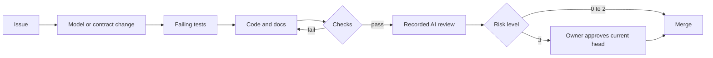

# shipping-reference-platform

A reference monorepo that shows how a Java and React product can be built when the architecture model, the
API contract and the documentation lead and the code follows, and when each claim about the code is backed by a
check that fails. The domain is generic webshop parcel shipping: quote a parcel, book it, download a label. Data is
synthetic and the carrier is simulated.

**State:** the specification (model, contract, decisions, module specifications, risk policy, agent rules), the
reviewed toolchain and the enforced dependency allowlist are here. Application code is not written yet: every product
capability in `docs/capabilities/capabilities.yaml` is `planned`, and that file is the source of truth for status and
evidence. The table below marks each control **enforced** (it runs and can fail today) or **planned**.

## The idea

- **The structure is written down and checked in both directions.** `architecture/workspace.dsl` is a C4 model in
  Structurizr DSL. The API's seven modules are its components, each mapped to a Java package. Every dependency
  between modules is an explicit relationship, marked `REQUIRED` (the code must reference it) or `PERMITTED` (the
  code may). The library in `libs/c4-contract-kit` reads the model and the compiled classes and fails the build when
  code depends on a module the model does not allow, and when code lacks a dependency the model requires. A
  permitted dependency with no reference is reported as "no static evidence", not as a failure.
- **The HTTP interface is written down before it is coded.** `contracts/shipping.openapi.yaml` (OpenAPI 3.1.2,
  RFC 9457 errors) is what the Java controllers are tested against and what the TypeScript client is generated from.
- **Agents write most of the code; checks decide whether it stays.** Every pull request gets a risk level from 0 to
  3. Levels 0 to 2 need green checks and a recorded AI review. Level 3 (pricing, bookings, personal data,
  authentication, tenant isolation, migrations, dependencies, and the controls themselves) also needs the owner's
  approval of the exact final version.
- **Every third-party component is reviewed before it can run.** A base-branch preflight rejects anything not in
  `security/allowlist.json` before a build starts.



## The product in one paragraph

A shipping clerk of a webshop (a tenant) enters a parcel and a route and gets comparable offers priced by a
published synthetic tariff, each valid for 30 minutes. Booking an offer is idempotent per tenant and
`Idempotency-Key`: booking twice returns the same shipment. The clerk downloads a simulated SVG label. An audit
module records each booking from an event, deduplicated and replayed after failures. Tenants never see each other's
data, enforced in queries and by forced PostgreSQL row-level security.

| Module | v0.1 target, not implemented | Depends on (from the model) |
|---|---|---|
| `quotes` | built | `tenants` (REQUIRED) |
| `shipments` | built | `quotes`, `tenants` (REQUIRED) |
| `tenants` | built (minimal) | nothing |
| `audit` | built (minimal) | `shipments`, `tenants` (REQUIRED); `quotes` (PERMITTED, no static evidence yet) |
| `orders` | planned, no code | `quotes`, `shipments` (PERMITTED, not evaluated) |
| `tracking` | planned, no code | `shipments` (PERMITTED, not evaluated) |
| `returns` | planned, no code | `shipments` (PERMITTED, not evaluated) |

## Controls and how each one can fail

| Control | Fails the build when | What it cannot catch | Where it runs | Status |
|---|---|---|---|---|
| C4 conformance: divergence | A class in one module references another module without a relationship in the model. | Use through reflection, SQL, HTTP or configuration; a model widened to allow the dependency (that change needs the owner). | `java`: `ArchitectureConformanceTest` | planned (the library is in review; the application test needs application code) |
| C4 conformance: absence | A `REQUIRED` relationship has no static reference in the bytecode. | A reference that exists while the behaviour behind it does nothing. | `java`: `ArchitectureConformanceTest` | planned (as above) |
| Model validity | Package mappings overlap, are empty or leave classes uncovered; a planned module has code; forbidden DSL directives; tags disagree with contract properties; cycles. | Whether the model describes the right architecture. | `java` | planned (in the library, in review) |
| Module boundaries and layering | Access to another module's internal packages, module cycles, Spring in domain code, unexpected packages. | Coupling through shared data or timing. | `java`: `ModularityTest`, `HexagonalLayeringTest` | planned |
| API contract | A response deviates from the OpenAPI schema; the regenerated TypeScript client differs from the committed one. | Operations and status codes no test exercises. | `java`: `*HttpContractTest`; `web` | planned |
| Tenant isolation | A tenant table lacks forced row-level security; the runtime role could bypass it; another tenant's IDs are readable through SQL or HTTP. | SQL run as the owner role; the shared event publication table; strength of the demo authentication. | `java`: `RowLevelSecurityCatalogTest`, `RowLevelSecurityIntegrationTest`, `CrossTenantAccessTest` | planned |
| Domain invariants | Golden tariff prices, monotonicity and rounding properties, idempotent booking, expiry rules. | Wrong requirements. | `java` (parameterized property tests included: `SyntheticTariffPropertiesTest`) | planned |
| Event delivery | A failed audit write is lost, or a replay has a second effect. | Consumers nobody has written yet. | `java`: `AuditReplayIntegrationTest` | planned |
| Mutation testing | Fewer than 80 % of mutants on changed lines are killed (90 % for pricing and checker code). | Tests that consistently assert the wrong thing; hand-reviewed equivalent mutants. | `mutation` | planned |
| Dependency allowlist, before use | A component lacks an approved, unexpired review; a lockfile or checksum disagrees with it; an Action is not pinned by SHA. | Build code that downloads executables itself, compromised approved artifacts, runner compromise, local agents bypassing CI. | `preflight` (base-branch workflow) | **enforced**: a required check, proven to fail |
| Risk-levelled approval | A level 3 change lacks the owner's approval of its current head. | A sensitive change that matches no rule; a single approver is not two-person review. | `risk-approval` | planned |
| AI review record | No AI review with findings and dispositions is recorded for the final commit. | AI reviewers being wrong. | `ai-review` | planned |
| Web behaviour and accessibility | Quote, book and label fail in a real browser against the real API; axe-core finds violations; import cycles or boundary breaks. | Accessibility problems that automated tools miss; unused frontend modules. | `web`, `contract-e2e` | planned |
| Documentation and brain | Generated docs or `BRAIN.md` drift; budgets exceeded; a capability claims `shipped` without passing evidence; code changed without its module document. | Whether the prose is right. | `docs-brain` | planned |

Every advertised failure requires a deliberate negative fixture; none exists yet. The full list of limits is in `docs/gaps.md`.

## Layout

```text
architecture/workspace.dsl       C4 model: structural authority (ADR 0002)
contracts/shipping.openapi.yaml  HTTP contract (ADR 0004)
apps/shipping-api/               Gradle project :apps:shipping-api, Spring Boot modular monolith
apps/shipping-web/               npm workspace, React workbench
libs/c4-contract-kit/            Gradle project :libs:c4-contract-kit, the model-versus-code checker
packages/shipping-client/        npm workspace, client generated from the contract
docs/                            npm workspace (VitePress): adr/, modules/, flows/, capabilities/, gaps.md, ui/
policy/                          risk.json (risk levels), rulesets.json (later)
security/                        allowlist.json and reviews/ (bootstrap pull request)
tools/                           policy checker, brain generator, web import check (later)
build-logic/, gradle/            Gradle conventions, wrapper and verification metadata (later)
.github/                         CODEOWNERS; workflows (later)
AGENTS.md                        rules for AI agents; scoped files in apps/*, libs/*, security/
BRAIN.md                         generated agent entry point (later)
```

## Running it

From a clean clone, with the reviewed JDK (Temurin 25.0.5+8) on `JAVA_HOME`. Install it by hand from the archive
whose SHA-256 is in `security/verifications/2026-11-06-toolchain.md`: Gradle's toolchain auto-download is off.

| Step | Command |
|---|---|
| Check every dependency against the allowlist (the JDK alone; nothing from the repository runs) | `java tools/policy/PolicyCheck.java .` |
| Run all Java checks (compile with Error Prone and NullAway, tests) | `./gradlew check` |
| Run mutation tests on changed code | `<mutation>` |

Not built yet; their commands arrive with their code: a toolchain bootstrap script, PostgreSQL 18.6 with the two
roles, the API with the `demo` profile, the workbench, web checks, contract and end-to-end tests, and the brain.

## Honest limits

- A `REQUIRED` edge proves that a static reference exists, not that the behaviour behind it runs. Integration tests
  carry behavioural claims, and one demonstration shows a broken audit listener that passes the architecture check.
- "No static evidence" does not mean unused. Reflection, configuration and SQL are invisible to bytecode analysis.
- The model can be weakened to make a failing build pass. The checker does not understand intent; the owner's
  approval on model changes is the control.
- Authentication is a demo scheme with public, guessable tokens. It proves tenant derivation and isolation, not
  login security.
- Pre-use dependency enforcement covers declared dependencies on the sanctioned CI path only.
- The tariff, carrier and labels are fictional. Nothing here is production-ready, and nothing is deployed.

## Approval

Agent-authored changes receive recorded automated review; sensitive changes additionally receive the owner’s human
approval. This demonstrates accountable human oversight, not independent two-person review or a production-security
certification.

## Prior art

The comparison of a model with code in both directions is decades old; this repository applies it to a Structurizr
model and Java bytecode and adds required-edge semantics and evidence. The research behind it, including which tools
check in both directions and what 2025–2026 studies say about coding agents and architecture, is written up in
[Holding Code to Architecture in the Coding-Agent Era](https://www.dashecorp.com/codi-e/diagram-first-research/)
(Codi-E blog, 6 November 2026).

- **Reflexion models**, Gail Murphy, David Notkin and Kevin Sullivan, ACM SIGSOFT FSE 1995: map code onto a model
  and report convergences, divergences and absences. <https://www.cs.ubc.ca/~murphy/papers/rm/fse95.html>
- **ArchUnit** by TNG: the bytecode analysis this repository uses; its PlantUML component rules check permitted
  dependencies in one direction.
  <https://www.archunit.org/userguide/html/000_Index.html#_plantuml_component_diagrams_as_rules>
- **Spring Modulith** by the Spring team: the application's module framework; it verifies module boundaries from
  the code's own structure, in one direction. <https://docs.spring.io/spring-modulith/reference/>
- **jQAssistant with the Structurizr plugin** by Materna: imports a Structurizr DSL model into a graph for
  user-written rules; the closest open-source overlap. <https://github.com/materna-se/structurizr-jqassistant-plugin>
- **dependency-cruiser** by Sander Verweij: `forbidden`, `allowed` and `required` rules for JavaScript and
  TypeScript. <https://github.com/sverweij/dependency-cruiser/blob/main/doc/rules-reference.md>
- **Lattix**: commercial architecture enforcement whose "Must Use" rules fail when a dependency is missing.
  <https://docs.lattix.com/lattix/userGuide/Monitoring_and_Enforcing_Architecture.html>
- **Structurizr DSL and the C4 model** by Simon Brown: the modelling language and notation.
  <https://docs.structurizr.com/dsl>, <https://c4model.com/>

## Licence

Except for the third-party material identified in [THIRD-PARTY-NOTICES.md](THIRD-PARTY-NOTICES.md), all original
code, configuration, models, specifications, ADRs, security reviews and documentation are licensed under the
[Apache License 2.0](LICENSE). See [NOTICE](NOTICE) for attribution.
