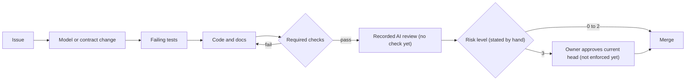

# shipping-reference-platform

A reference monorepo that shows how a Java and TypeScript product can be built when the architecture model, the
API contract and the documentation lead and the code follows, and when each claim about the code is backed by a
check that fails. The domain is generic webshop parcel shipping: quote a parcel, book it, download a label. Data is
synthetic and the carrier is simulated. The application's first code exists: the pricing and quotes of the API's
quotes module and the tenant context they need, without HTTP or a database; most of the application is still planned.
The tooling that judges it exists too: a checker that holds compiled Java classes to the C4 model in both directions,
a dependency allowlist check and a documentation tool.

## What exists today

Built and running:

- **The checker**, `libs/c4-contract-kit`, described in [the next section](#the-checker). Its tests, and a check of
  the library against its own model, run in `java`, a check that a pull request must pass before it can merge.
- **The dependency allowlist check**, `tools/policy/PolicyCheck.java`. It needs only the JDK. It fails when a locked
  dependency, the Gradle wrapper or an Action has no approved, unexpired review in `security/allowlist.json`, or when
  a checksum differs from its review, and it refuses a checked tree that holds a symbolic link. The required
  `preflight` check runs the main branch's copy of it on every pull request that targets `main`, and refuses pull
  requests from forks. Its tests, `tools/policy/PolicyCheckTest.java`, need only the JDK too and run in `java`;
  before them, scripted tamperings (ADR 0007) and two pull requests made to fail on purpose
  ([security/README.md](security/README.md)) showed that it fails.
- **The shipping API's first code**, `apps/shipping-api`: in the `tenants` module the tenant's identity and the
  tenant bound to the current thread, and in the `quotes` module the synthetic tariff, rating, quote creation and the
  offer lookup, in the domain and application layers. Their tests use a store in memory, a fixed clock and
  deterministic IDs; no endpoint, database or running application exists yet. In `java`, `ArchitectureConformanceTest`
  checks the API's classes against the model with the checker, `ModularityTest` runs Spring Modulith's verification
  and `HexagonalLayeringTest` the layering rules, and each of the three also fails on fixtures that break it.
- **The documentation tool**, `tools/docs`, with its tests. It generates the C4 view pages, `BRAIN.md` and a static
  site. In `java`, it checks committed generated files for drift, repository-local links and anchors for validity,
  and shipped or partial capability claims against passing test evidence. The `pages` workflow scans the site before
  each upload and publishes it from `main` at <https://stig-johnny.github.io/shipping-reference-platform/>.

The specification is in place too: the model, the API contract, the decisions, the module specifications, the risk
policy and the agent rules, with the reviewed toolchain.

Planned, with no code yet: the API's other five modules, everything of quotes and tenants that needs HTTP or the
database, the workbench, a plain TypeScript app (ADR 0009), and the checks that need them; the generated API client
is deferred. In [docs/capabilities/capabilities.yaml](docs/capabilities/capabilities.yaml), the source of truth for
status and evidence, the quotes module's tariff and quote expiry are shipped and its quote creation and offer lookup
partial; every other product capability is `planned`. [docs/gaps.md](docs/gaps.md) lists what a green build does not
prove.

## The checker

`libs/c4-contract-kit` reads a C4 model written in Structurizr DSL and the compiled class files, without loading the
classes, and compares the two in both directions. A reference from one component to another that the model does not
declare fails the check as a divergence, which lists each reference: the classes and members on both ends, its kind,
and the source line where the class file records one. For relationships between built components, a `REQUIRED` one
that no class backs with a direct static reference fails the check as an absence, and a `PERMITTED` one without
references is reported as "no static evidence", not as a failure.

For example, a test fixture models a small shop in which `orders -> billing` is `REQUIRED`. Remove the one method in
`orders` that uses `billing`, and the check fails with an absence: "The model requires orders -> billing, but no class
of orders references a class of billing."

The evidence is the checker's own tests, and most of them are negative fixtures:

- [`ConformanceDivergenceTest`](libs/c4-contract-kit/src/test/java/io/github/stigjohnny/c4contractkit/rules/ConformanceDivergenceTest.java):
  every kind of direct reference that ArchUnit reports counts (field and parameter types, calls, annotations, lambdas,
  method references and more), and isolated classes may not depend on components or be depended on.
- [`ConformanceAbsenceTest`](libs/c4-contract-kit/src/test/java/io/github/stigjohnny/c4contractkit/rules/ConformanceAbsenceTest.java):
  a missing reference is an absence, a transitive path does not satisfy a `REQUIRED` relationship, and a relationship
  that touches a planned component is not evaluated.
- [`SelfConformanceTest`](libs/c4-contract-kit/src/test/java/io/github/stigjohnny/c4contractkit/api/SelfConformanceTest.java):
  the library conforms to its own model, `libs/c4-contract-kit/architecture/self.dsl`, in which each of the eight
  allowed edges between its five packages is `REQUIRED`; the same model with one edge removed fails with a divergence.

The checker also checks the shipping API: `ArchitectureConformanceTest` compares every main class-output directory of
`:apps:shipping-api` with `architecture/workspace.dsl` and writes its report to
`apps/shipping-api/build/reports/c4-contract/`. Two modules are built, `quotes` and `tenants`, so one relationship is
evaluated, `quotes -> tenants` (`REQUIRED`), and it converges; the other nine touch a planned module and are not
evaluated. With that relationship removed from the model, the same test shows the API's own classes failing the check
with a divergence. The library's API and rules are in `libs/c4-contract-kit/README.md`; what the check cannot prove is
in section 1 of [docs/gaps.md](docs/gaps.md#1-what-the-architecture-check-cannot-prove).

## Try it

From the repository root, with the reviewed JDK, Temurin 25.0.5+8, as `JAVA_HOME` and first on `PATH` (see
[Running it](#running-it)):

```bash
java tools/policy/PolicyCheck.java .
./gradlew :libs:c4-contract-kit:test --rerun \
    --tests '*SelfConformanceTest' --tests '*ConformanceDivergenceTest' --tests '*ConformanceAbsenceTest'
```

The first command checks the repository against the allowlist with the JDK alone and prints
`## Dependency allowlist: clean` (exit code 0; 1 means findings, 2 that the check could not complete). The second
compiles the library with Error Prone and NullAway and runs the three test classes above. `--rerun` runs them even
when Gradle holds an up-to-date result. Gradle lists only failed and skipped tests; every result is in
`libs/c4-contract-kit/build/reports/tests/test/index.html`.

A negative fixture passes by asserting the rejection: the test writes a model, compiles classes that break it, and
asserts the violation the checker must report, so a checker that let the fixture through would fail the build.
`SelfConformanceTest` also writes the checker's report on the library itself to
`libs/c4-contract-kit/build/reports/c4-contract-self/report.md` (and `report.json`): the verdict, each violation with
its evidence, and every edge with its status.

To see a failure on real code, delete the `reportPackage -> modelPackage` relationship from
`libs/c4-contract-kit/architecture/self.dsl` and run the second command again. `theLibraryConformsToItsSelfModel`
fails, and `report.md` shows `DIVERGENCE: report -> model` with the classes and source lines that use `model`.
`git checkout -- libs/c4-contract-kit/architecture/self.dsl` restores the file.

Measured on 2026-11-07 on an Apple M4 Mac with the JDK already installed: the allowlist check took under a second.
The test command took 62 seconds the first time, from an empty Gradle home, which includes downloading Gradle 9.8.2
(about 150 MB) and the dependencies, and about 3 seconds when run again while the Gradle daemon was still running.
Installing the JDK, or a slower network, adds to the first run.

## The idea

- **The structure is written down first.** `architecture/workspace.dsl` is a C4 model in Structurizr DSL. The API's
  seven modules are its components, each mapped to a Java package, and every dependency between modules is an
  explicit relationship, marked `REQUIRED` (the code must reference it) or `PERMITTED` (the code may). The checker
  holds the code to it once the code exists.
- **The HTTP interface is written down before it is coded.** `contracts/shipping.openapi.yaml` (OpenAPI 3.1.2,
  RFC 9457 errors) is what the Java controllers are to be tested against, which is planned. Generating the
  TypeScript client from it is deferred (ADR 0004): the web app's types are written by hand.
- **Agents write most of the code; checks decide whether it stays.** Under the accepted policy every pull request
  gets a risk level from 0 to 3. Levels 0 to 2 need green checks and a recorded AI review. Level 3 (pricing,
  bookings, personal data, authentication, tenant isolation, migrations, dependencies, and the controls themselves)
  also needs the owner's approval of the exact final version. Today the author states the level and the owner
  records the approval; the checks that are to compute the level and require the approval are planned
  ([docs/risk-levels.md](docs/risk-levels.md)).
- **A third-party component needs an approved review before it can be merged.** The required `preflight` check runs
  the main branch's allowlist check on the pull request's files, without running anything from them. It fails when a
  locked dependency, the wrapper or an Action has no approved review, or when a checksum differs from its review. The
  `java` job runs the same check before Gradle starts, so an unreviewed dependency stops it before Gradle downloads
  anything. A pull request can change `java.yml` and skip that step in its own run; it cannot change `preflight`.
  What this does not stop is in [security/README.md](security/README.md).

## How a change is made

The intended order of work. Of its steps, only the required checks are enforced today, as the text below the list
explains.



The workflow in the diagram, in order:

1. An issue states the change.
2. The model or the contract changes first.
3. Failing tests describe the new behaviour.
4. Code and documentation change until the tests pass.
5. The required checks run; when one fails, the change goes back to step 4.
6. An AI review is recorded.
7. The risk level decides: levels 0 to 2 merge; level 3 merges only after the owner approves the current head.

GitHub enforces step 5: branch protection on `main` requires the `preflight` and `java` checks, for administrators
too. Steps 1 to 4 and step 6 are rules for agents in `AGENTS.md`; no check verifies that they happened, or in that
order. Step 7 is manual: the author states the level and the owner records the approval of a level 3 change, but
branch protection requires no approval. The `ai-review` and `risk-approval` checks that are to enforce steps 6 and 7
are planned ([docs/risk-levels.md](docs/risk-levels.md)).

## The product in one paragraph

The planned v0.1 behaviour is: a shipping clerk of a webshop (a tenant) enters a parcel and a route and gets
comparable offers priced by a published synthetic tariff, each valid for 30 minutes. Booking an offer is idempotent
per tenant and `Idempotency-Key`: booking twice returns the same shipment. The clerk downloads a simulated SVG
label. An audit module records each booking from an event, deduplicated and replayed after failures. Tenants never
see each other's data, enforced in queries and by forced PostgreSQL row-level security.

| Module | Implementation state | Depends on (from the model) |
|---|---|---|
| `quotes` | Built in part: tariff, rating, quote creation and offer lookup, without HTTP or a database | `tenants` (REQUIRED) |
| `shipments` | Planned for v0.1; no code yet | `quotes`, `tenants` (REQUIRED) |
| `tenants` | Built in part: the tenant's identity and the tenant bound to the current thread; the rest of the minimal implementation is planned | nothing |
| `audit` | Minimal implementation planned for v0.1; no code yet | `shipments`, `tenants` (REQUIRED); `quotes` (PERMITTED, not evaluated) |
| `orders` | planned, no code | `quotes`, `shipments` (PERMITTED, not evaluated) |
| `tracking` | planned, no code | `shipments` (PERMITTED, not evaluated) |
| `returns` | planned, no code | `shipments` (PERMITTED, not evaluated) |

## Controls and how each one can fail

The status says which part of each control runs and can fail today (**enforced**, or **partial** where only part of
it runs) and which part is **planned**.

| Control | Fails the build when | What it cannot catch | Where it runs | Status |
|---|---|---|---|---|
| C4 conformance: divergence | A class in one module references another module without a relationship in the model. | Use through reflection, SQL, HTTP or configuration; references lost through constant inlining or not reported by ArchUnit, including casts; a model widened to allow the dependency (the owner's approval of such a change is not enforced yet). | `java`: `ArchitectureConformanceTest` | **enforced**: the checker's tests and the check of the API's classes run in `java`; a relationship that touches a planned module is not evaluated |
| C4 conformance: absence | A `REQUIRED` relationship has no static reference in the bytecode. | A reference that exists while the behaviour behind it does nothing. | `java`: `ArchitectureConformanceTest` | **enforced** (as above) |
| Model validity | Package mappings overlap, are empty or leave classes uncovered; a planned module has code; forbidden DSL directives; tags disagree with contract properties; cycles. | Whether the model describes the right architecture. | `java`: `RepositoryWorkspaceTest` reads `architecture/workspace.dsl` with the library; `ArchitectureConformanceTest` applies the rules that need classes | **enforced**: for the model file, and for the API's classes (uncovered classes, code in a planned module) |
| Module boundaries and layering | Access to another module's internal packages, module cycles, Spring in domain code, unexpected packages. | Coupling through shared data or timing. | `java`: `ModularityTest`, `HexagonalLayeringTest` | **enforced** for the built modules, each rule with a fixture that fails it |
| API contract | A response deviates from the OpenAPI schema. | Operations and status codes no test exercises; the web app's hand-written types drifting from the contract, because the generated client is deferred (ADR 0004). | `java`: `*HttpContractTest` | planned |
| Tenant isolation | A tenant table lacks forced row-level security; the runtime role could bypass it; another tenant's IDs are readable through SQL or HTTP. | SQL run as the owner role; the shared event publication table; strength of the demo authentication. | `java`: `RowLevelSecurityCatalogTest`, `RowLevelSecurityIntegrationTest`, `CrossTenantAccessTest` | planned |
| Domain invariants | Golden tariff prices, monotonicity and rounding properties, idempotent booking, expiry rules. | Wrong requirements. | `java` (parameterized property tests included: `SyntheticTariffPropertiesTest`) | partial: the tariff and expiry tests run in `java`; idempotent booking is planned |
| Event delivery | A failed audit write is lost, or a replay has a second effect. | Consumers nobody has written yet. | `java`: `AuditReplayIntegrationTest` | planned |
| Mutation testing | Fewer than 80 % of mutants on changed lines are killed (90 % for pricing and checker code). | Tests that consistently assert the wrong thing; hand-reviewed equivalent mutants. | `mutation` | planned (today the `mutation` job runs PIT on the contract kit and fails under 90 % killed; it is not a required check) |
| Dependency allowlist, before use | A locked dependency, the Gradle wrapper or an Action has no approved, unexpired review; a checksum or a vendored file differs from its review; an Action is not pinned to an allowlisted commit; the reviewed set changed after the owner accepted it; the checked tree holds a symbolic link. | Build code that downloads executables itself, compromised approved artifacts, runner compromise, local agents bypassing CI, a reviewed component used outside the scope of its review. | `preflight` (from the base branch); `java` before Gradle starts, then the checker's tests (`tools/policy/PolicyCheckTest.java`) | **enforced**: `preflight` is a required check, made to fail on purpose by pull requests #16 and #17 (`security/README.md`). Planned, which is why `capabilities.yaml` still lists the control as planned: a schema for the allowlist, the checker's acceptance tests named there (its JDK-only tests run in `java` but write no JUnit report), and approval bound to a pull request's head |
| Risk-levelled approval | A level 3 change lacks the owner's approval of its current head. | A sensitive change that matches no rule; a single approver is not two-person review. | `risk-approval` | planned |
| AI review record | No AI review with findings and dispositions is recorded for the final commit. | AI reviewers being wrong. | `ai-review` | planned |
| Web behaviour and accessibility | Quote, book and label fail in a real browser against the real API; axe-core finds violations; import cycles or boundary breaks. | Accessibility problems that automated tools miss; unused frontend modules. | `web`, `contract-e2e`; the import check in `java` (ADR 0009) | planned |
| Documentation and brain | Generated docs or `BRAIN.md` drift; budgets exceeded; a capability claims `shipped` without passing evidence; a link, anchor or ADR reference is broken; the site's Mermaid bundle differs from its review; code changed without its module document. | Whether the prose is right. | `java`: `:tools:docs:check` (`BrainGeneratorTest`, `BrainCheckTest`, `SiteBuilderTest`) | **enforced** in the required `java` check, except the module-document check, which is planned |
| Publication scan of the public site | The built site holds a secret's shape, a link to this repository on GitHub, a local path, a private address or host name, an HTML comment or a term of the confidential dictionary; the dictionary is missing; the Mermaid bundle differs from its review; the site directory holds a link or a hidden file. | A paraphrase, a confidential term that is not in the dictionary, what a sentence means. | `pages`, build job: `:tools:docs:scanSite` before the upload (`PublicationScannerTest`, `PagesWorkflowTest`) | **enforced** on every deployment from `main`; the dictionary is a secret of the `github-pages` environment, and without it the scan fails closed |

Every advertised failure requires a deliberate negative fixture. The checker's own tests have theirs, the
documentation and brain control has them in `BrainCheckTest` and `SiteBuilderTest`, and the API's architecture tests
have theirs; the application's other controls are planned and have none yet. The allowlist check's JDK-only tests,
`tools/policy/PolicyCheckTest.java`, build theirs in temporary directories; before them, scripted tamperings
(ADR 0007) and the closed pull requests that `security/README.md` lists showed that it fails. The full list of
limits is in `docs/gaps.md`.

## Layout

```text
architecture/workspace.dsl       C4 model of the product: the structural authority (ADR 0002)
contracts/shipping.openapi.yaml  HTTP contract (ADR 0004)
libs/c4-contract-kit/            Gradle project :libs:c4-contract-kit, the model-versus-code checker, with its
                                 self-model architecture/self.dsl
apps/shipping-api/               Gradle project :apps:shipping-api: the first code of the quotes and tenants modules, with
                                 their tests and the architecture tests
apps/shipping-web/               the workbench's agent rules (AGENTS.md); the workbench itself is planned
docs/                            Markdown with frontmatter: adr/, modules/, flows/, capabilities/, ui/, demos/ (one
                                 demonstration per pull request, how to write one, and the milestone deck), gaps.md,
                                 risk-levels.md; architecture/ and brain/ are generated by tools/docs
policy/                          risk.json (risk levels)
security/                        allowlist.json, reviews/ and verifications/, explained in README.md
tools/policy/                    PolicyCheck.java, the dependency allowlist check, and PolicyCheckTest.java, its tests
tools/ci/                        stage-temurin.sh: downloads the CI JDK and checks its SHA-256
tools/docs/                      Gradle project :tools:docs: docs, brain and site generator, publication scan
build-logic/                     Gradle convention plugins: compiler settings, Error Prone and NullAway, locking, PIT
gradle/                          wrapper, version catalog (libs.versions.toml), verification metadata
.github/                         CODEOWNERS; the pull request template; workflows preflight.yml, java.yml and pages.yml
AGENTS.md                        rules for AI agents; scoped files in apps/*, libs/*, security/
BRAIN.md                         generated agent entry point
```

Planned and not in the tree yet: `policy/rulesets.json` (the branch ruleset). Deferred: `packages/shipping-client/`
(the client generated from the contract, ADR 0004). The web import check is to be part of `libs/c4-contract-kit`, not
a `tools/web-imports/` script (ADR 0009).

## Running it

From a clean clone, with the reviewed JDK (Temurin 25.0.5+8) as `JAVA_HOME` and on `PATH`. Install it by hand from
the archive whose SHA-256 is in `security/verifications/2026-11-06-toolchain.md`: Gradle's toolchain auto-download is
off.

| Step | Command |
|---|---|
| Check every dependency against the allowlist (the JDK alone; runs the repository's policy checker without invoking the build) | `java tools/policy/PolicyCheck.java .` |
| Test the allowlist checker (the JDK alone) | `java tools/policy/PolicyCheckTest.java` |
| Run all Java checks (compile with Error Prone and NullAway, tests) | `./gradlew check` |
| Run mutation tests (CI only, the `mutation` job: PIT's control socket accepts unauthenticated connections) | `./gradlew :libs:c4-contract-kit:pitest` |
| Check docs and the brain; regenerate them | `./gradlew :tools:docs:check`; `./gradlew :tools:docs:generate` |
| Build the documentation site into `tools/docs/build/site/` (open its `index.html`) | `./gradlew :tools:docs:site` |

Not built yet; their commands arrive with their code: a developer toolchain bootstrap script, PostgreSQL 18.6 with
the two roles, the API with the `demo` profile, the workbench, web checks, and contract and end-to-end tests.

## Honest limits

- A `REQUIRED` edge proves that a static reference exists, not that the behaviour behind it runs. Integration tests
  are to carry the behavioural claims, and a demonstration with a broken audit listener that passes the architecture
  check is planned (slice 10 in `libs/c4-contract-kit/AGENTS.md`); neither exists yet.
- "No static evidence" does not mean unused. Reflection, configuration and SQL are invisible to bytecode analysis.
- The model can be weakened to make a failing build pass. The checker does not understand intent; the owner's
  approval of model changes is the intended control, and it is not enforced yet.
- The planned authentication is a demo scheme with public, guessable tokens. It is to prove tenant derivation and
  isolation, not login security.
- Pre-use dependency enforcement covers declared dependencies on the sanctioned CI path only.
- The tariff, carrier and labels are fictional. Nothing here is production-ready. The application is not deployed
  anywhere; only the documentation site is published.

## Prior art

The comparison of a model with code in both directions is decades old; this repository applies it to a Structurizr
model and Java bytecode and adds required-edge semantics and evidence. The research behind it, including which tools
check in both directions and what 2025–2026 studies say about coding agents and architecture, is written up in
[Holding Code to Architecture in the Coding-Agent Era](https://www.dashecorp.com/codi-e/diagram-first-research/)
(Codi-E blog, 6 November 2026).

- **Reflexion models**, Gail Murphy, David Notkin and Kevin Sullivan, ACM SIGSOFT FSE 1995: map code onto a model
  and report convergences, divergences and absences. <https://www.cs.ubc.ca/~murphy/papers/rm/fse95.html>
- **ArchUnit** by TNG: the bytecode analysis this repository uses; its PlantUML component rules check permitted
  dependencies in one direction.
  <https://www.archunit.org/userguide/html/000_Index.html#_plantuml_component_diagrams_as_rules>
- **Spring Modulith** by the Spring team: the application's module framework; it verifies module boundaries from
  the code's own structure, in one direction. <https://docs.spring.io/spring-modulith/reference/>
- **jQAssistant with the Structurizr plugin** by Materna: imports a Structurizr DSL model into a graph for
  user-written rules; the closest open-source overlap. <https://github.com/materna-se/structurizr-jqassistant-plugin>
- **dependency-cruiser** by Sander Verweij: `forbidden`, `allowed` and `required` rules for JavaScript and
  TypeScript. <https://github.com/sverweij/dependency-cruiser/blob/main/doc/rules-reference.md>
- **Lattix**: commercial architecture enforcement whose "Must Use" rules fail when a dependency is missing.
  <https://docs.lattix.com/lattix/userGuide/Monitoring_and_Enforcing_Architecture.html>
- **Structurizr DSL and the C4 model** by Simon Brown: the modelling language and notation.
  <https://docs.structurizr.com/dsl>, <https://c4model.com/>

## Licence

Except for the third-party material identified in [THIRD-PARTY-NOTICES.md](THIRD-PARTY-NOTICES.md), all original
code, configuration, models, specifications, ADRs, security reviews and documentation are licensed under the
[Apache License 2.0](LICENSE). See [NOTICE](NOTICE) for attribution.
