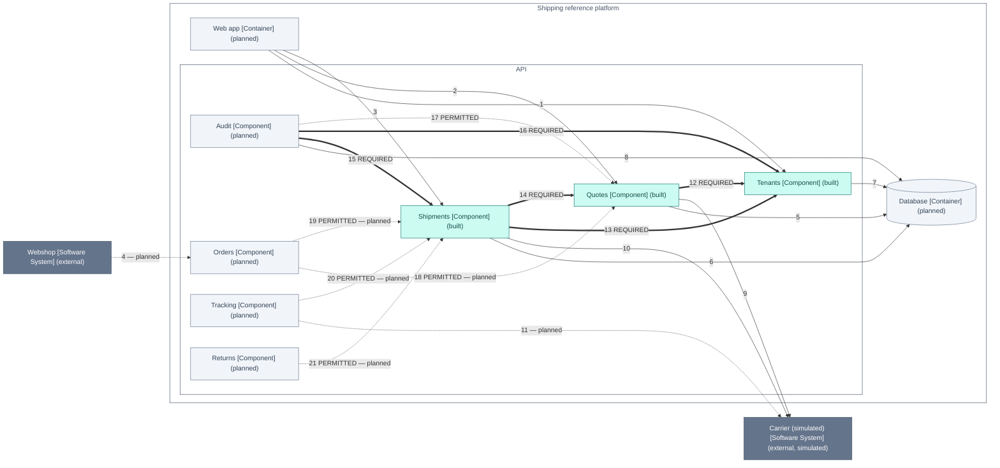

> Generated—do not hand-edit. Source: `architecture/workspace.dsl`, view `ApiComponents`. Regenerate with
> `./gradlew :tools:docs:generate`; `:tools:docs:checkGenerated` fails on any difference.

# C4 view: Components of the API

The seven modules of the API and the dependencies between them: REQUIRED, PERMITTED or planned. Planned modules and dependencies are labelled as planned.

[Open this diagram on the documentation site for enlargement and its text equivalent](https://stig-johnny.github.io/shipping-reference-platform/model/api-components.html#figure-api-components)

The same definition is in [api-components.mmd](api-components.mmd).

## How to read it

- Each box is an element of the model: its name, its C4 type in brackets and, in parentheses, its implementation status.
- "(planned)" marks an element that has no code yet.
- Each line is labelled with its number in the view's relationships table and, where it has one, its mode.
- A thick line is a REQUIRED dependency between modules. Where both modules are built, the checker in libs/c4-contract-kit fails when the compiled classes have no static reference for it.
- A dotted line labelled PERMITTED is a dependency between modules that the code may have; the checker requires no reference for it and reports one without any as "no static evidence".
- The checker does not evaluate a line that touches a planned module until both modules are built.
- A dotted line labelled planned is a relationship that does not exist yet.
- A solid thin line is a relationship of people, systems or containers, which module conformance does not cover.
- Arrows point from the element that depends on the other.

## Elements

| ID | Element | Type | Technology | Status | Description |
|---|---|---|---|---|---|
| 3 | Webshop | Software System |  | external | A merchant's online shop (simulated). Source of the orders that need shipping. |
| 4 | Carrier (simulated) | Software System |  | external, simulated | A fictional parcel carrier. v0.1 simulates its tariff, tracking numbers and labels inside the API; no network calls. |
| 6 | Web app | Container | Plain TypeScript SPA (no framework), TypeScript 5.9.3 | Planned; not covered by module conformance | Shipping workbench for clerks: parcel form, comparable quote cards, shipment list and detail drawer. |
| 14 | Quotes | Component | Spring Modulith module | built | Prices parcels with the synthetic tariff and issues quotes whose offers expire after 30 minutes. |
| 15 | Shipments | Component | Spring Modulith module | built | Books shipments from quote offers with tenant-scoped idempotency, cancels them and renders simulated labels. Publishes ShipmentBooked and ShipmentCancelled. |
| 16 | Tenants | Component | Spring Modulith module | built | Authenticates synthetic users, derives the tenant from membership, binds it to every database transaction for row-level security, and evaluates prototype flags. |
| 17 | Audit | Component | Spring Modulith module | planned | Appends one tenant-scoped audit entry per shipment event, deduplicated by event ID; replayed from the publication registry after failures. |
| 18 | Orders | Component | Spring Modulith module | planned | Planned: imports webshop orders and turns them into quote and booking requests. |
| 19 | Tracking | Component | Spring Modulith module | planned | Planned: receives carrier tracking events and moves shipments through transit states. |
| 20 | Returns | Component | Spring Modulith module | planned | Planned: creates return shipments for delivered shipments. |
| 21 | Database | Container | PostgreSQL 18.6 | Planned; not covered by module conformance | One schema per v0.1 module (quotes, shipments, tenants, audit) plus the event publication registry. Forced row-level security on tenant data. |

## Relationships

| # | From | To | Description | Technology | Line |
|---|---|---|---|---|---|
| 1 | Web app | Tenants | Authenticates every API request with the demo bearer token; reads the current membership and prototype flags | JSON over HTTPS | solid: not covered by module conformance |
| 2 | Web app | Quotes | Creates and reads quotes | JSON over HTTPS | solid: not covered by module conformance |
| 3 | Web app | Shipments | Books, lists, reads and cancels shipments; downloads labels | JSON over HTTPS | solid: not covered by module conformance |
| 4 | Webshop | Orders | Will submit orders to ship | JSON over HTTPS | dotted: planned |
| 5 | Quotes | Database | Stores quotes and offers in schema quotes | Spring JDBC (JdbcClient) | solid: not covered by module conformance |
| 6 | Shipments | Database | Stores shipments and idempotency keys in schema shipments; writes event publications | Spring JDBC (JdbcClient) | solid: not covered by module conformance |
| 7 | Tenants | Database | Resolves demo tokens through a security-definer function, reads prototype flags, sets app.tenant_id in every transaction | JDBC | solid: not covered by module conformance |
| 8 | Audit | Database | Appends audit entries in schema audit | Spring JDBC (JdbcClient) | solid: not covered by module conformance |
| 9 | Quotes | Carrier (simulated) | Prices each service level from the carrier's synthetic tariff (simulated in-process) | In-process simulation | solid: not covered by module conformance |
| 10 | Shipments | Carrier (simulated) | Assigns simulated tracking numbers and renders simulated labels (in-process) | In-process simulation | solid: not covered by module conformance |
| 11 | Tracking | Carrier (simulated) | Will receive tracking events | HTTPS webhook | dotted: planned |
| 12 | Quotes | Tenants | Resolves the caller's tenant (tenants.api: CurrentTenant, TenantId) | Java | thick: REQUIRED dependency |
| 13 | Shipments | Tenants | Resolves the caller's tenant (tenants.api: CurrentTenant, TenantId) | Java | thick: REQUIRED dependency |
| 14 | Shipments | Quotes | Books only against an existing, unexpired offer (quotes.api: QuoteOffers, OfferLookup, Money, ServiceLevel) | Java | thick: REQUIRED dependency |
| 15 | Audit | Shipments | Records the ShipmentBooked and ShipmentCancelled events that shipments publishes (shipments.api) | Spring Modulith event listener | thick: REQUIRED dependency |
| 16 | Audit | Tenants | Writes each audit entry inside the event's tenant scope (tenants.api: TenantScope, TenantId) | Java | thick: REQUIRED dependency |
| 17 | Audit | Quotes | May record QuoteIssued events; no listener exists in v0.1, so the report shows no static evidence | Spring Modulith event listener | dotted: PERMITTED dependency |
| 18 | Orders | Quotes | Will request quotes for imported orders | Java | dotted: PERMITTED dependency, planned |
| 19 | Orders | Shipments | Will book shipments for imported orders | Java | dotted: PERMITTED dependency, planned |
| 20 | Tracking | Shipments | Will move shipments through carrier transit states | Java | dotted: PERMITTED dependency, planned |
| 21 | Returns | Shipments | Will create return shipments for delivered shipments | Java | dotted: PERMITTED dependency, planned |

## What this view cannot show

- A diagram shows the model, not the code. The API's modules are checked against its compiled classes and the web app's parts against its TypeScript imports (docs/gaps.md, section 1).
- Arrows between modules are static code dependencies, not runtime data flow: an event listener's arrow points to the module whose event type it uses.
- A REQUIRED arrow specifies an obligation; where both modules are built, a passing conformance check establishes a static reference, not runtime behaviour.
