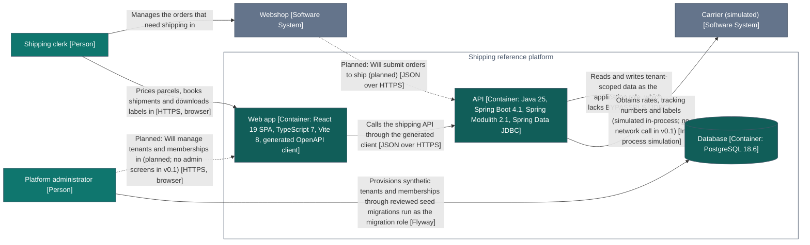

> Generated—do not hand-edit. Source: `architecture/workspace.dsl`, view `Containers`. Regenerate with
> `./gradlew :tools:docs:generate`; `:tools:docs:checkGenerated` fails on any difference.

# C4 view: Containers

The web app, the API (one deployable modular monolith) and the database.

The same definition is in [containers.mmd](containers.mmd).

## How to read it

- Each box is an element of the model, with its C4 type in brackets.
- A dotted line labelled Planned is a relationship that does not exist yet.
- A solid thin line is a relationship of people, systems or containers, which the Java check does not evaluate.
- Arrows point from the element that depends on the other.

## Elements

| ID | Element | Type | Technology | Status | Description |
|---|---|---|---|---|---|
| 1 | Shipping clerk | Person |  | no status: not a checked module | Works for a webshop. Prices parcels, books shipments and downloads labels. |
| 2 | Platform administrator | Person |  | no status: not a checked module | Provisions tenants and memberships for webshops. |
| 3 | Webshop | Software System |  | external | A merchant's online shop (simulated). Source of the orders that need shipping. |
| 4 | Carrier (simulated) | Software System |  | external, simulated | A fictional parcel carrier. v0.1 simulates its tariff, tracking numbers and labels inside the API; no network calls. |
| 6 | Web app | Container | React 19 SPA, TypeScript 7, Vite 8, generated OpenAPI client | no status: not a checked module | Shipping workbench for clerks: parcel form, comparable quote cards, shipment list and detail drawer. |
| 7 | API | Container | Java 25, Spring Boot 4.1, Spring Modulith 2.1, Spring Data JDBC | no status: not a checked module | Modular monolith exposing contracts/shipping.openapi.yaml. Modules are packages; each has a public api package and private internals. |
| 15 | Database | Container | PostgreSQL 18.6 | no status: not a checked module | One schema per v0.1 module (quotes, shipments, tenants, audit) plus the event publication registry. Forced row-level security on tenant data. |

## Relationships

| # | From | To | Description | Technology | Line |
|---|---|---|---|---|---|
| 1 | Shipping clerk | Webshop | Manages the orders that need shipping in |  | solid: not checked by the Java check |
| 2 | Shipping clerk | Web app | Prices parcels, books shipments and downloads labels in | HTTPS, browser | solid: not checked by the Java check |
| 3 | Platform administrator | Web app | Will manage tenants and memberships in (planned; no admin screens in v0.1) | HTTPS, browser | dotted: planned |
| 4 | Platform administrator | Database | Provisions synthetic tenants and memberships through reviewed seed migrations run as the migration role | Flyway | solid: not checked by the Java check |
| 5 | Web app | API | Calls the shipping API through the generated client | JSON over HTTPS | solid: not checked by the Java check |
| 6 | Webshop | API | Will submit orders to ship (planned) | JSON over HTTPS | dotted: planned |
| 7 | API | Database | Reads and writes tenant-scoped data as the application role, which lacks BYPASSRLS | JDBC | solid: not checked by the Java check |
| 8 | API | Carrier (simulated) | Obtains rates, tracking numbers and labels (simulated in-process; no network call in v0.1) | In-process simulation | solid: not checked by the Java check |

## What this view cannot show

- A diagram shows the model, not the code. Only the API's modules are checked against the code (docs/gaps.md, section 1).
- Relationships of people, software systems and containers are documentation: they carry no contract mode, and Java static analysis does not check them. The contract and end-to-end tests cover the web app's calls.
