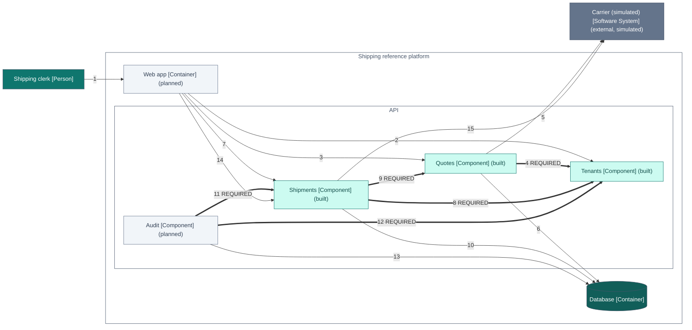

> Generated—do not hand-edit. Source: `architecture/workspace.dsl`, view `QuoteBookLabel`. Regenerate with
> `./gradlew :tools:docs:generate`; `:tools:docs:checkGenerated` fails on any difference.

# C4 view: Quote, book and download a simulated label

Quote, book and download a simulated label. The documentation overview of the whole flow: it is not executable, and the views whose keys start with Scenario are the ones run against the code. Steps and their tests: docs/flows/quote-book-label.md.

[Open this diagram on the documentation site for enlargement and its text equivalent](https://stig-johnny.github.io/shipping-reference-platform/model/quote-book-label.html#figure-quote-book-label)

The same definition is in [quote-book-label.mmd](quote-book-label.mmd).

## How to read it

- Each box is an element of the model: its name, its C4 type in brackets and, in parentheses, its implementation status.
- "(planned)" marks an element that has no code yet.
- Each line is labelled with its number in the view's relationships table and, where it has one, its mode.
- A thick line is a REQUIRED dependency between modules. Where both modules are built, the checker in libs/c4-contract-kit fails when the compiled classes have no static reference for it.
- The checker does not evaluate a line that touches a planned module until both modules are built.
- A solid thin line is a relationship of people, systems or containers, which module conformance does not cover.
- Arrows point from the element that depends on the other.

## Elements

| ID | Element | Type | Technology | Status | Description |
|---|---|---|---|---|---|
| 1 | Shipping clerk | Person |  | Role; implementation status not applicable | Works for a webshop. Prices parcels, books shipments and downloads labels. |
| 4 | Carrier (simulated) | Software System |  | external, simulated | A fictional parcel carrier. v0.1 simulates its tariff, tracking numbers and labels inside the API; no network calls. |
| 6 | Web app | Container | Plain TypeScript SPA (no framework), TypeScript 5.9.3 | Planned; not covered by module conformance | Shipping workbench for clerks: parcel form, comparable quote cards, shipment list and detail drawer. |
| 14 | Quotes | Component | Spring Modulith module | built | Prices parcels with the synthetic tariff and issues quotes whose offers expire after 30 minutes; postgres selects its JDBC store. |
| 15 | Shipments | Component | Spring Modulith module | built | Books shipments with tenant-scoped idempotency and renders simulated labels; postgres selects its JDBC store and tracking sequence. Publishes ShipmentBooked. Cancellation is planned. |
| 16 | Tenants | Component | Spring Modulith module | built | Authenticates synthetic users and derives the tenant from membership; postgres selects the JDBC token directory. Prototype flags and event TenantScope are planned. |
| 17 | Audit | Component | Spring Modulith module | planned | Appends one tenant-scoped audit entry per shipment event, deduplicated by event ID; replayed from the publication registry after failures. |
| 21 | Database | Container | PostgreSQL 18.6 | Not covered by module conformance | One schema per v0.1 module plus the event publication registry, with forced row-level security on tenant data. Built: the schemas tenants, quotes and shipments (migrations V1 to V3; CI verification pending), with JDBC adapters selected by the postgres profile. Planned: audit and the registry. |

## Relationships

| Step | From | To | Description | Technology | Line |
|---|---|---|---|---|---|
| 1 | Shipping clerk | Web app | Prices a parcel, books an offer and downloads its label | HTTPS, browser | solid: not covered by module conformance |
| 2 | Web app | Tenants | Sends the demo bearer token; the tenant is derived from the user's membership | JSON over HTTPS | solid: not covered by module conformance |
| 3 | Web app | Quotes | POST /api/v1/quotes (createQuote) | JSON over HTTPS | solid: not covered by module conformance |
| 4 | Quotes | Tenants | Resolves the caller's tenant | Java | thick: REQUIRED dependency |
| 5 | Quotes | Carrier (simulated) | Rates each service level with the synthetic tariff | In-process simulation | solid: not covered by module conformance |
| 6 | Quotes | Database | Stores the quote and its offers; publishes QuoteIssued | Spring JDBC (JdbcClient) | solid: not covered by module conformance |
| 7 | Web app | Shipments | POST /api/v1/shipments with an Idempotency-Key (bookShipment) | JSON over HTTPS | solid: not covered by module conformance |
| 8 | Shipments | Tenants | Resolves the caller's tenant | Java | thick: REQUIRED dependency |
| 9 | Shipments | Quotes | Checks that the offer exists for this tenant and has not expired | Java | thick: REQUIRED dependency |
| 10 | Shipments | Database | Stores the shipment, its idempotency key and the ShipmentBooked publication in one transaction | Spring JDBC (JdbcClient) | solid: not covered by module conformance |
| 11 | Audit | Shipments | Receives ShipmentBooked after the booking commits (listener; arrow shows the code dependency) | Spring Modulith event listener | thick: REQUIRED dependency |
| 12 | Audit | Tenants | Binds the event's tenant before writing | Java | thick: REQUIRED dependency |
| 13 | Audit | Database | Appends one audit entry per event ID; the publication is marked complete | Spring JDBC (JdbcClient) | solid: not covered by module conformance |
| 14 | Web app | Shipments | GET the label of the shipment (getShipmentLabel) | JSON over HTTPS | solid: not covered by module conformance |
| 15 | Shipments | Carrier (simulated) | Renders the simulated SVG label | In-process simulation | solid: not covered by module conformance |

## What this view cannot show

- A diagram shows the model, not the code. The API's modules are checked against its compiled classes and the web app's parts against detected TypeScript imports using partial lint (docs/gaps.md, section 1).
- Each numbered step is a relationship of the model, in the order of the flow. Where a listener handles another module's event, its arrow shows the code dependency, not the direction in which the event travels; the authored sequence diagrams under docs/flows/ describe runtime delivery.
