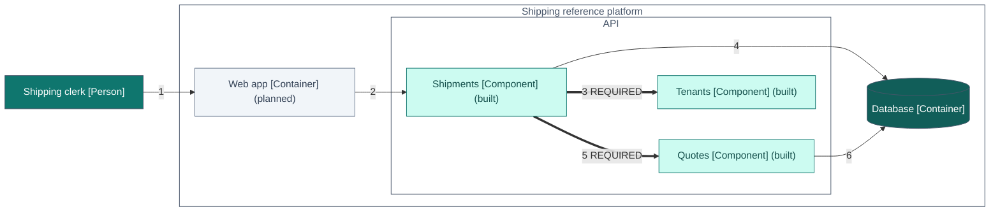

> Generated—do not hand-edit. Source: `architecture/workspace.dsl`, view `ScenarioTenantDenial`. Regenerate with
> `./gradlew :tools:docs:generate`; `:tools:docs:checkGenerated` fails on any difference.

# C4 view: Executable scenario: another tenant's quote is not found

Executable scenario: another tenant's quote is not found. TenantDenialScenarioTest runs it on the code and checks its steps (architecture/scenarios/scenario-tenant-denial.json).

[Open this diagram on the documentation site for enlargement and its text equivalent](https://stig-johnny.github.io/shipping-reference-platform/model/scenario-tenant-denial.html#figure-scenario-tenant-denial)

The same definition is in [scenario-tenant-denial.mmd](scenario-tenant-denial.mmd).

## How to read it

- Each box is an element of the model: its name, its C4 type in brackets and, in parentheses, its implementation status.
- "(planned)" marks an element that has no code yet.
- Each line is labelled with its number in the view's relationships table and, where it has one, its mode.
- A thick line is a REQUIRED dependency between modules. Where both modules are built, the checker in libs/c4-contract-kit fails when the compiled classes have no static reference for it.
- A solid thin line is a relationship of people, systems or containers, which module conformance does not cover.
- Arrows point from the element that depends on the other.

## Elements

| ID | Element | Type | Technology | Status | Description |
|---|---|---|---|---|---|
| 1 | Shipping clerk | Person |  | Role; implementation status not applicable | Works for a webshop. Prices parcels, books shipments and downloads labels. |
| 6 | Web app | Container | Plain TypeScript SPA (no framework), TypeScript 5.9.3 | Planned; not covered by module conformance | Shipping workbench for clerks: parcel form, comparable quote cards, shipment list and detail drawer. |
| 14 | Quotes | Component | Spring Modulith module | built | Prices parcels with the synthetic tariff and issues quotes whose offers expire after 30 minutes; postgres selects its JDBC store. |
| 15 | Shipments | Component | Spring Modulith module | built | Books shipments with tenant-scoped idempotency and renders simulated labels; postgres selects its JDBC store and tracking sequence. Publishes ShipmentBooked. Cancellation is planned. |
| 16 | Tenants | Component | Spring Modulith module | built | Authenticates synthetic users and derives the tenant from membership; postgres selects the JDBC token directory; the demo web adapter serves local static assets with strict CSP. Prototype flags and event TenantScope are planned. |
| 21 | Database | Container | PostgreSQL 18.6 | Not covered by module conformance | One schema per v0.1 module plus the event publication registry, with forced row-level security on tenant data. Built: the schemas tenants, quotes and shipments (migrations V1 to V3; CI verification pending), with JDBC adapters selected by the postgres profile. Planned: audit and the registry. |

## Relationships

| Step | From | To | Description | Technology | Line |
|---|---|---|---|---|---|
| 1 | Shipping clerk | Web app | A clerk of Tenant Beta books an offer of Tenant Alpha's quote | HTTPS, browser | solid: not covered by module conformance |
| 2 | Web app | Shipments | POST /api/v1/shipments (bookShipment), answered 404 quote-not-found, as for an unknown quote | JSON over HTTPS | solid: not covered by module conformance |
| 3 | Shipments | Tenants | CurrentTenant.require(): Tenant Beta | Java | thick: REQUIRED dependency |
| 4 | Shipments | Database | Looks up the Idempotency-Key for Tenant Beta: no earlier shipment | Spring JDBC (JdbcClient) | solid: not covered by module conformance |
| 5 | Shipments | Quotes | QuoteOffers.findOffer for Tenant Beta: QuoteNotFound | Java | thick: REQUIRED dependency |
| 6 | Quotes | Database | Selects the quote by Tenant Beta and its ID: no row | Spring JDBC (JdbcClient) | solid: not covered by module conformance |

## What this view cannot show

- A diagram shows the model, not the code. The API's modules are checked against its compiled classes and the web app's parts against detected TypeScript imports using partial lint (docs/gaps.md, section 1).
- Each numbered step is a relationship of the model, in the order of the flow. Where a listener handles another module's event, its arrow shows the code dependency, not the direction in which the event travels; the authored sequence diagrams under docs/flows/ describe runtime delivery.
