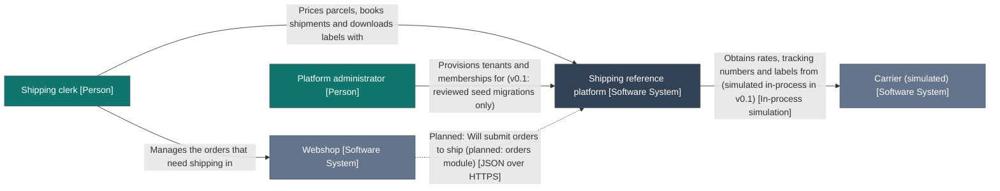

> Generated—do not hand-edit. Source: `architecture/workspace.dsl`, view `SystemContext`. Regenerate with
> `./gradlew :tools:docs:generate`; `:tools:docs:checkGenerated` fails on any difference.

# C4 view: System context

Who uses the platform and which systems it talks to.

The same definition is in [system-context.mmd](system-context.mmd).

## How to read it

- Each box is an element of the model, with its C4 type in brackets.
- A dotted line labelled Planned is a relationship that does not exist yet.
- A solid thin line is a relationship of people, systems or containers, which the Java check does not evaluate.
- Arrows point from the element that depends on the other.

## Elements

| ID | Element | Type | Technology | Status | Description |
|---|---|---|---|---|---|
| 1 | Shipping clerk | Person |  | no status: not a checked module | Works for a webshop. Prices parcels, books shipments and downloads labels. |
| 2 | Platform administrator | Person |  | no status: not a checked module | Provisions tenants and memberships for webshops. |
| 3 | Webshop | Software System |  | external | A merchant's online shop (simulated). Source of the orders that need shipping. |
| 4 | Carrier (simulated) | Software System |  | external, simulated | A fictional parcel carrier. v0.1 simulates its tariff, tracking numbers and labels inside the API; no network calls. |
| 5 | Shipping reference platform | Software System |  | no status: not a checked module | Quotes, books and labels parcels for webshop tenants. |

## Relationships

| # | From | To | Description | Technology | Line |
|---|---|---|---|---|---|
| 1 | Shipping clerk | Webshop | Manages the orders that need shipping in |  | solid: not checked by the Java check |
| 2 | Shipping clerk | Shipping reference platform | Prices parcels, books shipments and downloads labels with |  | solid: not checked by the Java check |
| 3 | Platform administrator | Shipping reference platform | Provisions tenants and memberships for (v0.1: reviewed seed migrations only) |  | solid: not checked by the Java check |
| 4 | Webshop | Shipping reference platform | Will submit orders to ship (planned: orders module) | JSON over HTTPS | dotted: planned |
| 5 | Shipping reference platform | Carrier (simulated) | Obtains rates, tracking numbers and labels from (simulated in-process in v0.1) | In-process simulation | solid: not checked by the Java check |

## What this view cannot show

- A diagram shows the model, not the code. Only the API's modules are checked against the code (docs/gaps.md, section 1).
- Relationships of people, software systems and containers are documentation: they carry no contract mode, and Java static analysis does not check them. The contract and end-to-end tests cover the web app's calls.
