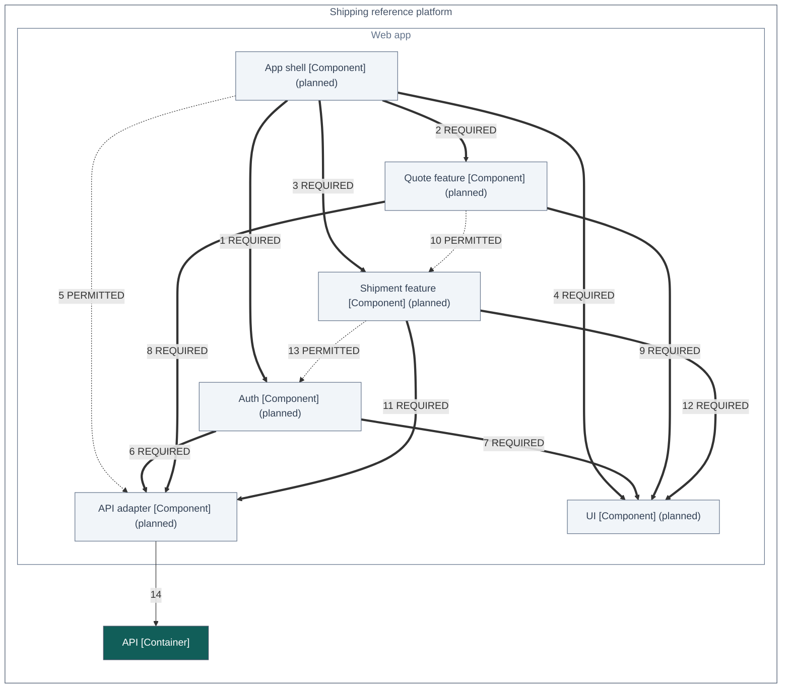

> Generated—do not hand-edit. Source: `architecture/workspace.dsl`, view `WebComponents`. Regenerate with
> `./gradlew :tools:docs:generate`; `:tools:docs:checkGenerated` fails on any difference.

# C4 view: Components of the Web app

The six parts of the web app and the imports allowed between them: REQUIRED, PERMITTED or planned. The web import check holds apps/shipping-web/src to these lines; every part is planned until its code exists.

[Open this diagram on the documentation site for enlargement and its text equivalent](https://stig-johnny.github.io/shipping-reference-platform/model/web-components.html#figure-web-components)

The same definition is in [web-components.mmd](web-components.mmd).

## How to read it

- Each box is an element of the model: its name, its C4 type in brackets and, in parentheses, its implementation status.
- "(planned)" marks an element that has no code yet.
- Each line is labelled with its number in the view's relationships table and, where it has one, its mode.
- A thick line is a REQUIRED import between parts of the web app. Where both parts are built, the web import check in libs/c4-contract-kit fails when no file of the one imports a file of the other.
- A dotted line labelled PERMITTED is an import between parts of the web app that the sources may have; the check requires none for it and reports one without any as "no static evidence".
- The check does not evaluate a line that touches a planned part until both parts are built; a file in a planned part fails it.
- A solid thin line is a relationship of people, systems or containers, which module conformance does not cover.
- Arrows point from the element that depends on the other.

## Elements

| ID | Element | Type | Technology | Status | Description |
|---|---|---|---|---|---|
| 7 | App shell | Component | TypeScript | planned; checked by the web import check | Left navigation, the router on the History API, the theme and the route outlet; mounts the app. |
| 8 | Auth | Component | TypeScript | planned; checked by the web import check | Synthetic user picker and sign-in; holds the demo token and the membership in memory only. |
| 9 | API adapter | Component | TypeScript | planned; checked by the web import check | The typed HTTP adapter, the only caller of fetch: hand-written request and response types, the bearer token and Correlation-Id on every call. |
| 10 | Quote feature | Component | TypeScript | planned; checked by the web import check | ParcelForm, QuoteCardList and QuoteCard: price a parcel and compare its offers. |
| 11 | Shipment feature | Component | TypeScript | planned; checked by the web import check | BookingForm, ShipmentTable and ShipmentDrawer: book, list and open shipments and download their labels (LabelPreview is deferred). |
| 12 | UI | Component | TypeScript, CSS | planned; checked by the web import check | Presentational components: Button, ProblemAlert, EmptyState, StatusBadge, Skeleton and ThemeToggle. |
| 13 | API | Container | Java 25, Spring Boot 4.1, Spring Modulith 2.1, Spring JDBC (JdbcClient) | Not covered by module conformance | Modular monolith exposing contracts/shipping.openapi.yaml. Modules are packages; each has a public api package and private internals. |

## Relationships

| # | From | To | Description | Technology | Line |
|---|---|---|---|---|---|
| 1 | App shell | Auth | Shows the signed-in user, the sign-in route and Switch user from | TypeScript import | thick: REQUIRED dependency |
| 2 | App shell | Quote feature | Routes /quotes/new and /quotes/:quoteId to (through features/quotes/index.ts) | TypeScript import | thick: REQUIRED dependency |
| 3 | App shell | Shipment feature | Routes /shipments and /shipments/:shipmentId to (through features/shipments/index.ts) | TypeScript import | thick: REQUIRED dependency |
| 4 | App shell | UI | Renders the navigation and ThemeToggle with | TypeScript import | thick: REQUIRED dependency |
| 5 | App shell | API adapter | May give the API adapter the token from auth through | TypeScript import | dotted: PERMITTED dependency |
| 6 | Auth | API adapter | Signs in with getCurrentMembership through | TypeScript import | thick: REQUIRED dependency |
| 7 | Auth | UI | Renders the user picker and its problems with | TypeScript import | thick: REQUIRED dependency |
| 8 | Quote feature | API adapter | Creates and reads quotes through | TypeScript import | thick: REQUIRED dependency |
| 9 | Quote feature | UI | Renders the form, the offer cards and their states with | TypeScript import | thick: REQUIRED dependency |
| 10 | Quote feature | Shipment feature | May show BookingForm under the chosen offer (through features/shipments/index.ts) | TypeScript import | dotted: PERMITTED dependency |
| 11 | Shipment feature | API adapter | Books, lists, reads and cancels shipments and downloads labels through | TypeScript import | thick: REQUIRED dependency |
| 12 | Shipment feature | UI | Renders the table, the drawer and their states with | TypeScript import | thick: REQUIRED dependency |
| 13 | Shipment feature | Auth | May read the prototype flags of the current membership from | TypeScript import | dotted: PERMITTED dependency |
| 14 | API adapter | API | Calls the shipping API using handwritten request and response types | JSON over HTTPS | solid: not covered by module conformance |

## What this view cannot show

- A diagram shows the model, not the code. The API's modules are checked against its compiled classes and the web app's parts against its TypeScript imports (docs/gaps.md, section 1).
- Arrows between the web app's parts are static imports of TypeScript files, read from apps/shipping-web/src with a restricted import grammar, not runtime calls.
- A REQUIRED arrow specifies an obligation; where both parts are built, a passing web import check establishes an import, not runtime behaviour. The API adapter's calls to the API are network calls, which no static check sees.
