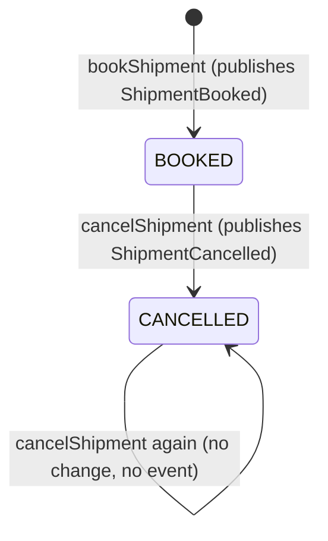

# Module: shipments

Package `io.github.stigjohnny.shipping.shipments`. C4 component `shipments` (`contract.status built`). Risk level 3:
bookings and personal data (recipient names and addresses, synthetic only).

## Implementation state

The attended `demo` runtime now supplies disposable memory storage; `demo,postgres` selects the existing JDBC
adapter with standard datasource environment variables. `DemoSmokeTest` exercises the real HTTP quote-to-label
flow with memory storage; the matching `DemoPostgresSmokeIntegrationTest` compiles but awaits CI. See the
[runbook](../flows/attended-demo.md) and [ADR 0018](../adr/0018-attended-demo-runtime.md).

Built: booking, listing, reading and simulated labels over HTTP. `ShipmentsController` maps the existing
`BookShipment` outcomes; `ShipmentsConfiguration` wires `GetShipment`, `ListShipments` and `RenderLabel` through application ports.
`ShipmentsHttpContractTest` starts the application with in-memory quote and shipment stores, deterministic IDs and
tracking numbers, and a fixed clock. Every exercised response is checked against the unchanged OpenAPI contract,
including raw SVG. It proves sequential replay after expiry, all booking rejections, tenant isolation for detail and
labels, newest-first keyset pages including tied timestamps, tenant/filter-bound cursors and input validation.
`SvgLabelRendererTest` checks exact golden bytes, escaping, the allowed XML vocabulary and the decorative bars.

The four built shipment capabilities remain partial: persistence, transactional publication, concurrent booking and
cancellation are unproven. `ShipmentTest` covers booking only. `ShipmentStatus` still has `BOOKED` only; the HTTP
`CANCELLED` list filter is accepted and returns no matches until cancellation exists. There is no cancellation route,
no cancelled state to replay and no `409 shipment-cancelled` label outcome yet.

Built under `postgres`: `JdbcShipmentStore`, `JdbcTrackingNumbers`, migration V3 and its down script. Every
statement binds the transaction-local tenant before its SQL. The unchanged HTTP test configuration continues to
use in-memory stores. Spring's JDBC transaction manager must enclose the whole `BookShipment.handle` call, at
PostgreSQL's default READ COMMITTED isolation. The adapters' transaction annotations also cover standalone port calls.
`ShipmentListingIntegrationTest` shares its exact store contract with `InMemoryStoresTest`.
`BookingIdempotencyIntegrationTest` covers real overlapping transactions; execution is pending CI.

Planned: `ShipmentCancelled`, cancellation and durable event publication.
The migration reserves cancellation and version columns, but the application still writes and reads BOOKED only.
No new event publication claim is made.

`TenantDenialScenarioTest` separately asserts Beta's booking rejection, no stored shipment for Beta, and Alpha's
still-bookable offer. Two declared API calls are evaluated, but the ledger retains 215 distinct known coverage gaps
from the HTTP edge, JDBC adapters and quotes/shipments factories. The expected verdict is `COVERAGE_INCOMPLETE`.
Exact ledger matching is build acceptance with known debt, not proof of conformance. Closing the classified gaps
is phase 3 / option 2 (ADR 0013).

**Scenario coverage ledger:** the owner accepted 15 exact demo findings for issue #92, bringing the ledger to
215 distinct findings: 115 HTTP/security accesses, 94 JDBC accesses and six factory parameters. ADR 0013 records
the acceptance. Existing classifications and the census, matching, duplicate and bypass checks are unchanged.
Every finding remains a coverage refusal; the expected verdict is `COVERAGE_INCOMPLETE`.

## Responsibilities

- Book exactly one shipment per quote, from one of its offers, only while the offer is unexpired, and only for the
  quote's tenant.
- Make booking idempotent per tenant and `Idempotency-Key`: the same key and body return the same shipment.
- Cancel booked shipments (v0.1 lifecycle `BOOKED -> CANCELLED`).
- List and read shipments of the caller's tenant.
- Render a simulated, clearly marked SVG label on request.
- Publish `ShipmentBooked` and `ShipmentCancelled` in the transaction that changes the shipment.

Not its job: pricing (quotes), carrier integration, tracking states (planned tracking module), returns (planned),
invoicing.

## Relationships (from `architecture/workspace.dsl`)

| Direction | Other component | Mode | Meaning |
|---|---|---|---|
| shipments -> quotes | quotes | REQUIRED | Books only against an existing, unexpired offer (`QuoteOffers.findOffer`). |
| shipments -> tenants | tenants | REQUIRED | Resolves the caller's tenant (`CurrentTenant`, `TenantId`). |
| audit -> shipments | audit | REQUIRED | Audit records `ShipmentBooked` and `ShipmentCancelled`. |
| orders, tracking, returns -> shipments | planned | PERMITTED | Not evaluated while those modules are planned. |

## Public API: `io.github.stigjohnny.shipping.shipments.api`

Annotated `@NamedInterface("api")` and `@NullMarked`. Kept deliberately small: only what consumers of its events need.

| Type | Shape |
|---|---|
| `ShipmentId` | `record ShipmentId(UUID value)` |
| `ShipmentBooked` | `record ShipmentBooked(UUID eventId, TenantId tenantId, ShipmentId shipmentId, Instant occurredAt)` |
| `ShipmentCancelled` | `record ShipmentCancelled(UUID eventId, TenantId tenantId, ShipmentId shipmentId, Instant occurredAt)` |

Event payloads contain no recipient data and no quotes types, so a consumer of these events does not gain a
dependency on quotes (this keeps the PERMITTED `audit -> quotes` edge free of evidence). Event rules: ADR 0006.

## HTTP operations (`contracts/shipping.openapi.yaml`, tag `shipments`)

| operationId | Method and path | Success | Module-specific problems |
|---|---|---|---|
| `bookShipment` | `POST /api/v1/shipments` (header `Idempotency-Key`) | `201` `Shipment`; `200` replay with `Idempotency-Replayed: true` | `404 quote-not-found`, `404 offer-not-found`, `409 quote-already-booked`, `422 quote-expired`, `422 recipient-does-not-match-quote`, `422 idempotency-key-reused` |
| `listShipments` | `GET /api/v1/shipments?limit&cursor&status` | `200` `ShipmentPage` | `400 validation-failed` for a bad cursor |
| `getShipment` | `GET /api/v1/shipments/{shipmentId}` | `200` `Shipment` | `404 shipment-not-found` |
| `cancelShipment` | `POST /api/v1/shipments/{shipmentId}/cancellation` | `200` `Shipment` | `404 shipment-not-found` |
| `getShipmentLabel` | `GET /api/v1/shipments/{shipmentId}/label` | `200` `image/svg+xml` | `404 shipment-not-found`, `409 shipment-cancelled` |

## Events

| Event | Published when | Consumers in v0.1 |
|---|---|---|
| `ShipmentBooked` | In `BookShipment`'s transaction, after the insert. Not on a replay or a rejection. | `audit` (`ShipmentAuditListener`) |
| `ShipmentCancelled` | In `CancelShipment`'s transaction, only for `BOOKED -> CANCELLED`. Not when already cancelled. | `audit` (`ShipmentAuditListener`) |

Consumes: none.

## Booking rules

The order of checks is part of the contract (description of `bookShipment`):

1. Tenant from `CurrentTenant.require()`.
2. Validate the key (`^[A-Za-z0-9_-]{16,64}$`) and the body.
3. Look up `(tenant, key)`. Same fingerprint: return `Replayed` with the current state of that shipment, even if the
   quote has expired or the shipment has been cancelled since. Different fingerprint: `IDEMPOTENCY_KEY_REUSED`.
4. `quoteOffers.findOffer(tenant, quoteId, offerId, clock.instant())`: `QuoteNotFound`, `OfferNotFound`, `Expired`
   map to the matching rejection.
5. The recipient's `countryCode` and `postcode` must equal the offer's destination (exact, case-sensitive; both are
   upper case by contract).
6. An existing shipment for the quote under another key gives `QUOTE_ALREADY_BOOKED`.
7. Create the shipment in `BOOKED`, assign the next tracking number, insert it with the key and fingerprint, publish
   `ShipmentBooked`, all in one transaction.

A rejected request stores nothing, so the same key sent again after a rejection is evaluated again from step 4.

Concurrency (ADR 0017): `findByKey` takes a transaction-scoped advisory lock in namespace 1 on the tenant/key;
`findByQuote` takes one in namespace 2 on the tenant/quote. Both use PostgreSQL `hashtext`; collisions serialize
unrelated requests. Each lookup runs in a separate statement after its lock, so READ COMMITTED sees the winner's
commit. All bookings acquire the key lock first, then the quote lock, and hold them to commit or rollback.
The unique constraints remain the final guard. Direct insert conflicts abort the transaction; they are never
caught and queried in an aborted transaction. These locks replace the planned exception/retry path for supported
booking calls. A writer bypassing that protocol gets a database error rather than a classified booking outcome.
`BookingIdempotencyIntegrationTest` covers matching and differing bodies, different keys for one quote, replay after
expiry, and expiry after a lock holder rolls back. It observes the blocked advisory lock through PostgreSQL's catalog.

**Request fingerprint:** SHA-256, lower-case hex, over the UTF-8 encoding of these fields in this order: `quoteId`,
`offerId`, `recipient.name`, `recipient.addressLine1`, `recipient.addressLine2`, `recipient.postcode`,
`recipient.city`, `recipient.countryCode`, `reference`. Each field is written as its UTF-8 byte length in decimal,
a colon, and the value; an absent optional field is written as `0:`. No separators. Values are used exactly as
received after validation; there is no trimming or case folding. Validation accepts well-formed Unicode only: a
recipient text field with a lone surrogate (a code unit from U+D800 to U+DFFF without its pair, which only a JSON
escape can carry) is rejected, since UTF-8 cannot encode it. A lenient encoder would write `?` in its place, so two
different requests would share a fingerprint, and a changed body would be replayed instead of refused. The
fingerprint's encoder refuses such text as well; it never replaces a character.

**Tracking numbers:** `SIM` followed by the next value of the database sequence `shipments.tracking_number_seq`,
left-padded with ASCII zeros to 10 ASCII digits (the first is `SIM0000000001`). Unique across tenants.
`JdbcTrackingNumbers` formats with `Locale.ROOT`, independent of the server's default locale.
`JdbcTrackingNumbersTest` checks the formatter under `ar-EG`, including padding, mixed digits and the sequence's
upper bound, without a database; it restores the default formatting locale after each case.

## Lifecycle

Planned later, by contract change: `BOOKED -> IN_TRANSIT -> DELIVERED` driven by the tracking module. A label
exists only for a `BOOKED` shipment.

## Simulated label

Rendered by `internal.domain.SvgLabelRenderer` from the stored shipment; never stored. Output is byte-identical for
identical input.

- UTF-8, LF line endings, starts with `<?xml version="1.0" encoding="UTF-8"?>`, at most 64 KiB.
- Root `<svg xmlns="http://www.w3.org/2000/svg" width="100mm" height="150mm" viewBox="0 0 1000 1500" role="img"
  aria-label="Simulated shipping label SIM...">` with a matching `<title>`.
- Elements allowed: `svg`, `title`, `rect`, `text`. Attributes allowed: `xmlns`, `width`, `height`, `viewBox`,
  `role`, `aria-label`, `x`, `y`, `fill`, `stroke`, `stroke-width`, `font-family` (always `sans-serif`),
  `font-size`, `font-weight`, `text-anchor`. No scripts, `<style>`, event attributes, links or external references.
- Content, top to bottom: the banner `SIMULATED LABEL - NOT VALID FOR CARRIAGE`; the service level; `FROM` with the
  origin country and postcode; `TO` with recipient name, address lines, postcode and city, and country; the
  tracking number as text; decorative bars; `REF` and the reference when present; `BOOKED` with the booking date
  (`YYYY-MM-DD`, UTC).
- Bars: for each of the ten digits `d` of the tracking number, left to right, one black `rect` of width `(d + 1) x 4`
  units and height 160 at `y = 1100`, starting at `x = 80`, with 8 units between bars. Not a barcode symbology.
- All text is XML-escaped (`&`, `<`, `>`, `"`, `'`). U+FFFE and U+FFFF are valid booking input but forbidden
  in XML 1.0; the label displays `[U+FFFE]` and `[U+FFFF]` for them, without changing stored data or schema bounds.
- HTTP headers: `Content-Type: image/svg+xml`, `Content-Disposition: attachment; filename="label-<tracking>.svg"`,
  `X-Content-Type-Options: nosniff`, `Content-Security-Policy: default-src 'none'; sandbox`, `Cache-Control: no-store`.

## Domain model: `internal.domain`

- `Shipment` (aggregate): `ShipmentId`, `TenantId`, `QuoteId`, `OfferId`, `ServiceLevel`, `Money price`,
  `ShipmentStatus`, `TrackingNumber`, `Place origin`, `Recipient`, `@Nullable ShipmentReference`, `IdempotencyKey`,
  `RequestFingerprint`, `Instant bookedAt`, `@Nullable Instant cancelledAt`, `int version`.
  `static Shipment book(...)` creates a `BOOKED` shipment; `CancellationResult cancel(Instant at)` returns
  `Cancelled(Shipment)` or `AlreadyCancelled(Shipment)`.
- `ShipmentStatus`: `BOOKED`, `CANCELLED`; `boolean canBecome(ShipmentStatus next)` allows only `BOOKED -> CANCELLED`.
- Values with validating constructors: `Recipient`, `ShipmentReference`, `TrackingNumber` (`^SIM[0-9]{10}$`),
  `IdempotencyKey`, `RequestFingerprint` (64 lower-case hex characters; `static RequestFingerprint of(BookingCommand)`).
- `BookingCommand(QuoteId, OfferId, Recipient, @Nullable ShipmentReference)`.
- `BookingOutcome`: `sealed interface permits Booked, Replayed, Rejected`; `Rejected(BookingRejection reason)`.
- `BookingRejection`: `QUOTE_NOT_FOUND`, `OFFER_NOT_FOUND`, `QUOTE_EXPIRED`, `RECIPIENT_DOES_NOT_MATCH_QUOTE`,
  `QUOTE_ALREADY_BOOKED`, `IDEMPOTENCY_KEY_REUSED`.
- `SvgLabelRenderer`: `String render(Shipment shipment)`; pure.

## Application: `internal.application`

- `BookShipment.handle(IdempotencyKey, BookingCommand) -> BookingOutcome` (`@Transactional`).
- CancelShipment.handle runs transactionally and returns Cancelled, AlreadyCancelled or NotFound. After an
  optimistic-lock conflict, resolve the current state in a fresh transaction; an already-cancelled shipment returns
  unchanged. Publish ShipmentCancelled only for the committed transition. ShipmentEventsIntegrationTest verifies
  concurrent cancellations return the same cancelled shipment and create one cancellation publication.
- `GetShipment.handle(ShipmentId) -> Optional<Shipment>`.
- `ListShipments.handle(ShipmentQuery) -> ListingOutcome` (`Listed(ShipmentSlice)` or `InvalidCursor`); keyset pagination on `(booked_at desc, shipment_id desc)`;
  the cursor is base64url (no padding) of `tenantId|bookedAt|shipmentId|statusFilter`; a cursor whose tenant or
  filter differs from the request is rejected. Canonical base64url, UUIDs and millisecond instants are required; the
  encoded cursor stays within the existing 200-character schema bound. The store reads `limit + 1` rows to decide
  whether a continuation exists, and the last page omits the cursor. UUID order is unsigned/lexical, as in PostgreSQL.
- `RenderLabel.handle(ShipmentId) -> LabelOutcome` (`Rendered(String svg, TrackingNumber)`, `NotFound`).
  The `ShipmentCancelled` outcome is planned with cancellation.
- Ports: `ShipmentStore` (insert, find by ID, find by key, find by quote, page; update with version check is planned),
  `TrackingNumbers` (`TrackingNumber next()`).
- Injected: `Clock`, `IdGenerator`, `CurrentTenant`, `QuoteOffers`, `ApplicationEventPublisher`, the ports.

## Adapters

- `internal.adapter.in.web`: `ShipmentsController` (book, list, read and label; cancellation planned), request and response records, mapping of
  outcomes to problems. Recipient data is never logged; request logging excludes bodies.
- `internal.adapter.out.jdbc`: `JdbcShipmentStore` (Spring JDBC's `JdbcClient`, ADRs 0012 and 0017), `JdbcTrackingNumbers` (sequence).
  Optimistic updates arrive with cancellation; current inserts leave the reserved version at zero.

## Data: schema `shipments` (migration `V3__shipments.sql`)

`shipments.shipment`: `tenant_id uuid`, `shipment_id uuid`, `quote_id uuid`, `offer_id uuid`, `status text`,
`service_level text`, `amount numeric(11,2)`, `currency char(3)`, `tracking_number char(13)`, `origin_country char(2)`,
`origin_postcode varchar(10)`, `recipient_name varchar(70)`, `recipient_address_line1 varchar(70)`,
`recipient_address_line2 varchar(70) null`, `recipient_postcode varchar(10)`, `recipient_city varchar(50)`,
`recipient_country char(2)`, `reference varchar(35) null`, `idempotency_key varchar(64)`,
`request_fingerprint char(64)`, `booked_at timestamptz`, `cancelled_at timestamptz null`, `version int default 0`; all other
columns `not null`.

- PK `(tenant_id, shipment_id)`; unique `(tenant_id, idempotency_key)`, `(tenant_id, quote_id)`,
  `(tenant_id, tracking_number)`.
- Checks: status and service level enums; `amount >= 0`; `currency = 'EUR'`; tracking number pattern;
  `(status = 'CANCELLED') = (cancelled_at is not null)`.
- Index `(tenant_id, booked_at desc, shipment_id desc)` for listing.
- Sequence `shipments.tracking_number_seq`: 1 through 9999999999, no cycling; rollback may leave gaps.
- Row-level security enabled and forced, policy `tenant_isolation`. Grants to `shipping_app`: `SELECT, INSERT,
  UPDATE` on the table, `USAGE` on the sequence. No `DELETE`.
- No foreign key to `quotes`; the quote's existence is checked through `QuoteOffers` in the same transaction.
- Event publications go to Spring Modulith's `event_publication` table (`V5__event_publication.sql`, ADR 0006).

## Invariants and the tests that assert them

| # | Invariant | Tests |
|---|---|---|
| S1 | Only `BOOKED -> CANCELLED` is allowed; cancelling twice changes nothing and publishes once. | `ShipmentTest`, `CancelShipmentTest` |
| S2 | Booking checks run in the documented order and map to the documented rejections. | `BookShipmentTest` |
| S3 | An offer is bookable only while `now < expiresAt`. | `BookShipmentTest`, `QuoteExpiryTest` |
| S4 | The recipient's country and postcode equal the quote's destination. | `BookShipmentTest` |
| S5 | Same tenant, key and body give the same shipment (`201` then `200`); a different body gives `422`; concurrent duplicates create one row. | `ShipmentsHttpContractTest` (sequential HTTP), `BookingIdempotencyIntegrationTest` (implemented; CI pending) |
| S6 | One shipment per quote; a second key for the same quote gives `409`. | `ShipmentsHttpContractTest` (sequential HTTP), `BookingIdempotencyIntegrationTest` (implemented; CI pending) |
| S7 | The fingerprint changes when any field changes and distinguishes absent from present optional fields. | `RequestFingerprintTest` |
| S8 | `ShipmentBooked` and `ShipmentCancelled` are published once on commit and never on rollback. | `ShipmentEventsIntegrationTest` |
| S9 | Labels are byte-identical for the same shipment, escape all text, contain only allowed elements and attributes, carry the simulation banner; a cancelled shipment has no label. | `SvgLabelRendererTest`, `ShipmentsHttpContractTest` |
| S10 | Listing is newest first, paginates without gaps or repeats, honours the status filter and rejects foreign cursors. | `ShipmentsHttpContractTest` (in memory), `ShipmentListingIntegrationTest` (implemented; CI pending) |
| S11 | Shipments of another tenant are never visible or changeable. | `ShipmentsHttpContractTest` (detail/label, in memory); `CrossTenantAccessTest`, `RowLevelSecurityIntegrationTest` (implemented; CI pending) |
| S12 | HTTP responses match the contract. | `ShipmentsHttpContractTest` |
| S13 | Recipient values are validated per the contract. | `RecipientTest` |
| S14 | Tracking numbers retain the `SIM[0-9]{10}` format regardless of the server's default formatting locale. | `JdbcTrackingNumbersTest` (formatter only, no database) |

Mutation testing: at least 80 % killed mutants on changed lines.

## Risk levels of its paths (`policy/risk.json`)

| Path | Level | Rule |
|---|---|---|
| `apps/shipping-api/src/main/java/io/github/stigjohnny/shipping/shipments/**` | 3 | `bookings-shipments` |
| `apps/shipping-api/src/test/java/io/github/stigjohnny/shipping/shipments/**` | 3 | `bookings-shipments` |
| `apps/shipping-api/src/main/resources/db/**` | 3 | `migrations` |

## Capabilities

`shipments.book-from-offer`, `shipments.idempotent-booking`, `shipments.cancel-shipment`,
`shipments.list-and-read`, `shipments.simulated-label`, `shipments.publish-events`
(`docs/capabilities/capabilities.yaml`).
